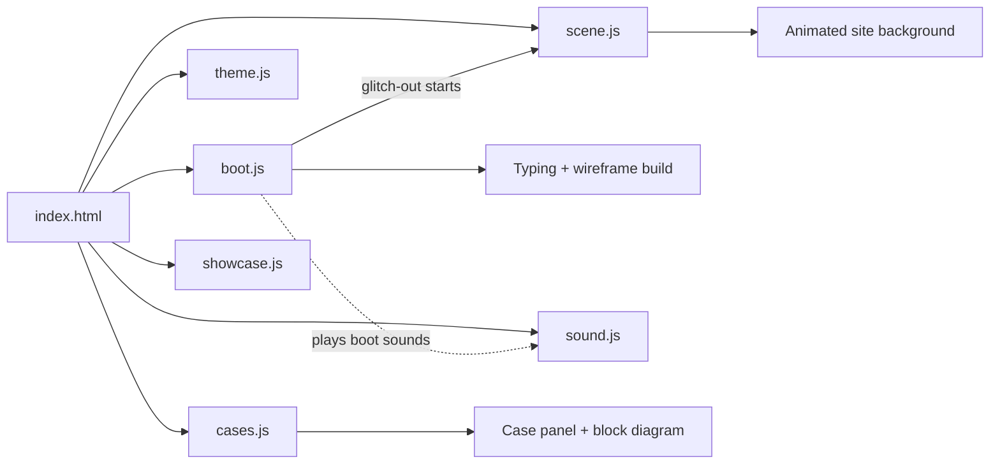

<div align="center">

```text
 ____    _      _ ___ ____    ____      _   _   _ ___
/ ___|  / \    | |_ _|  _ \  |  _ \    / \ | | | |_ _|
\___ \ / _ \ _ | || || | | | | |_) |  / _ \| |_| || |
 ___) / ___ \ || || || |_| | |  _ <  / ___ \  _  || |
|____/_/   \_\__/|___|____/  |_| \_\/_/   \_\_| |_|___|
```

### A portfolio that boots like a machine and builds itself in front of you.

**IoT & Robotics Engineer · Embedded Systems Designer · Video Editor & Graphic Designer**


<!-- Add a screenshot or GIF here once you have one:

-->

</div>

---

## ⚡ What is this?

This is the source of my personal portfolio. It is built with **plain HTML, CSS and JavaScript**: no framework, no bundler, no `node_modules`. Open `index.html` and it runs.

The idea: a developer's site should feel like a developer's site. So every section is introduced like a terminal command, the page opens with a **boot sequence**, and then it **compiles itself live** on screen.

```text
[ OK ] Checking memory ................. 16384 KB
[ OK ] Mounting /assets ................ 4 volumes
[ OK ] Loading typefaces ............... JetBrains Mono · IBM Plex Sans
[ OK ] Calibrating IoT sensors ......... 8/8 online
[ OK ] Spinning up servo drivers ....... PWM 50 Hz
[ OK ] Linking GitHub uplink ........... 24 ms
[ OK ] Starting portfolio.service ...... pid 2026
$ npm run dev
ready                                     compiled in 312 ms
```

*(there is no `npm run dev`. It is a joke, and the page really is that fast.)*

---

## ✨ Features

### 🖥️ Boot sequence and live build
- A black screen, a pop-up terminal window, a system boot log, then a **glitch-out** with RGB-split slices, jitter and flicker.
- Underneath, the page **compiles itself**. Text is typed character by character, cards appear as dashed wireframes labelled with their size (`<article.card> 540×208`) before they render, and images decode with a scan effect.
- Sections below the fold are built **when you scroll to them**.
- Occasional "hot reload" flicker on a random element, because why not.
- Click or press any key to skip. `prefers-reduced-motion` skips it entirely.

### 🤖 Living background
- An animated robotics and IoT scene: a patrolling drone, a waving robot, a robotic arm, a chip, gears, Wi-Fi waves and circuit traces with moving data packets.
- Sensor tags update with fake live readings (`temp 27.4 °C`, `rssi -52 dBm`).
- The artwork drifts gently with scroll (parallax driven by a CSS variable).
- A **cursor-following drone** flies on the background layer. It uses spring physics, banks into turns, and wanders on its own when you stop moving. It sits *behind* all content, so it can never cover anything.

### 🌗 Dark · Light · System theme
- Three-way switch in the dock. Follows the OS in *System* mode and syncs across open tabs.
- The theme is set in `<head>` before first paint, so there is **no flash**.
- The boot screen stays dark in every theme, because it is a terminal.

### 🔊 Sound, with zero audio files
- Every sound (key clicks, boot beeps, the glitch crunch, UI ticks) is **synthesised with the Web Audio API**.
- Muted by default, remembered in `localStorage`, and only unlocked after a real user gesture.

### 🧩 Case-study panels
- Click a project card to slide open a panel with a **demo video**, an **interactive block diagram**, a **"what I learned"** list and links.

### 🎬 Design, motion & photography showcase
- **Before / after slider** with mouse, touch and keyboard support, plus a small intro sweep that hints it is draggable.
- **Motion reel** that plays when visible and pauses when off-screen.
- **Lightbox gallery** with arrow keys, swipe and neighbour preloading.
- Missing files show a labelled placeholder (`Add assets/showcase/reel.mp4`) instead of a broken image.

### ♿ Accessibility and polish
- Skip link, semantic landmarks, `aria-pressed` and `aria-live` states, visible focus rings, native `<dialog>` for modals.
- Respects `prefers-reduced-motion` across the boot, drone, background and reveals.
- Responsive from phones to ultrawide, with a mobile nav and a stacked vertical block diagram on small screens.

---

## 🚀 Run it locally

No install needed.

```bash
git clone https://github.com/sajidrahii/<your-repo-name>.git
cd <your-repo-name>

# Option 1: just open index.html in a browser

# Option 2: serve it (recommended, so videos and fetch behave like production)
python -m http.server 8000
# → http://localhost:8000
```

Deploys as-is to **GitHub Pages**, Netlify, Vercel or any static host.

---

## 🗂️ Project structure

```text
.
├── index.html          # all content lives here
├── style.css           # design tokens, layout, components
├── animations.css      # shared keyframes
├── boot.css            # boot screen + live-build + background artwork
├── features.css        # theme, dock, drone, case panels, showcase, lightbox
│
├── script.js           # reveals, mobile nav, active link, CV download, cursor light
├── boot.js             # boot sequence, typing engine, wireframe build, glitch-out
├── scene.js            # shared robotics/IoT SVG artwork (boot screen + site background)
├── drone.js            # cursor-following drone (spring physics)
├── sound.js            # Web Audio synthesiser
├── theme.js            # dark / light / system switch
├── cases.js            # case-study panels + interactive block diagram
├── showcase.js         # before/after slider, motion reel, lightbox
├── projects.js         # project board count + "more below" fade
│
└── assets/
    ├── PDP01.png · PDP02.png · PDP03.png   # portrait illustrations
    ├── Lights.png · CursorLight.png        # background lighting
    ├── Sajid Rahi Logo.png
    ├── icons/ · social-icons/
    ├── projects/                           # project thumbnails + demo videos
    ├── showcase/                           # reel.mp4, before-1/after-1.jpg, gallery/01–05.jpg
    ├── achievements/                       # certificate images
    └── download/my-cv.png
```

---

## 🛠️ Make it yours

<details>
<summary><b>Add a project</b></summary>

1. In `index.html`, copy a whole `<article class="card project">` block and paste it at the end of the list. Give the title a button:
   ```html
   <h3><button type="button" class="case-open" data-case="my-project">My project</button></h3>
   ```
2. In `cases.js`, add an entry to `CASES` with the **same key**:
   ```js
   'my-project': {
     title: 'My project',
     summary: 'One or two sentences.',
     video: { src: 'assets/projects/demo.mp4', poster: 'assets/projects/cover.jpg' },
     flow: [ { icon: 'cam', name: 'Stage', sub: 'Role', kind: 'Type', text: '…', io: ['In: …', 'Out: …'] } ],
     learned: ['Lesson one', 'Lesson two'],
   }
   ```
Every part is optional. Leave out `video`, `flow`, `embed` or `learned` and that section simply does not appear. Tags and links are read straight from the card.
</details>

<details>
<summary><b>Tune the boot sequence</b></summary>

At the top of `boot.js`:
```js
const CONFIG = {
  alwaysPlay: true,   // false = full boot once per session, instant afterwards
  speed: 2,           // 1 = normal, 2 = twice as fast, 0.5 = slower
  hmr: true,          // occasional "hot reload" flicker
};
```
Boot log lines live in the `LINES` array.
</details>

<details>
<summary><b>Point the GitHub stats at another account</b></summary>

In `index.html`, set the username on the container:
```html
<div id="ghBody" data-user="your-username"></div>
```
</details>

<details>
<summary><b>Change colours and type</b></summary>

All design tokens are CSS variables at the top of `style.css`. The light theme overrides them in `features.css`.

| Token | Role |
|---|---|
| `--cyan` | Primary interactive: links, primary buttons, focus |
| `--violet` | Secondary: hover depth, one heading highlight |
| `--amber` | Tags and small indicators only |
| `--void` / `--panel` | Page and card surfaces |

Fonts: **JetBrains Mono** (display and UI) and **IBM Plex Sans** (body), loaded from Google Fonts.
</details>

<details>
<summary><b>Add showcase media</b></summary>

Drop files into `assets/showcase/` using the names in `index.html`. To add a gallery image, copy one `<button class="shot">` block. To add another slider, copy a whole `show__item--ba` block.
</details>

---

## 🧠 How it fits together



`scene.js` builds the robotics artwork once. The **boot screen** uses it at full strength, then the same artwork becomes the quieter **site background** the moment the boot screen starts leaving.

---

## 🔌 Featured build: Luscus

> **A computer-vision-based autonomous navigation system.** An ESP32-CAM streams frames over Wi-Fi, a YOLO model detects objects, and the detections decide how the motors drive. With no fresh frame, the robot stops.

```text
ESP32-CAM ──► Wi-Fi ──► YOLO ──► Motor control
 capture     transport   detect      act
```

---

## 📬 Say hello

I am open to internships, collaborations and embedded systems projects.

📧 **sajidahmedrahii@gmail.com** · 🐙 [GitHub](https://github.com/sajidrahii) · 💼 [LinkedIn](https://www.linkedin.com/in/sajid-rahi/)

---

<div align="center">

**© 2026 Sajid Rahi. Built line by line.**

<sub>If you like the boot screen, a ⭐ is the nicest handshake.</sub>

</div>
